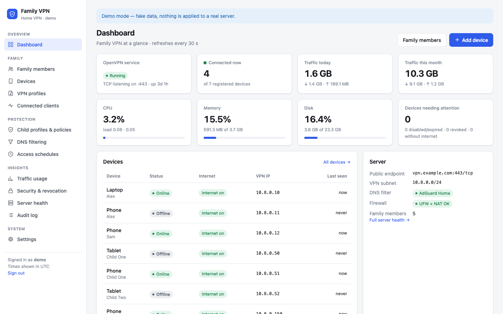
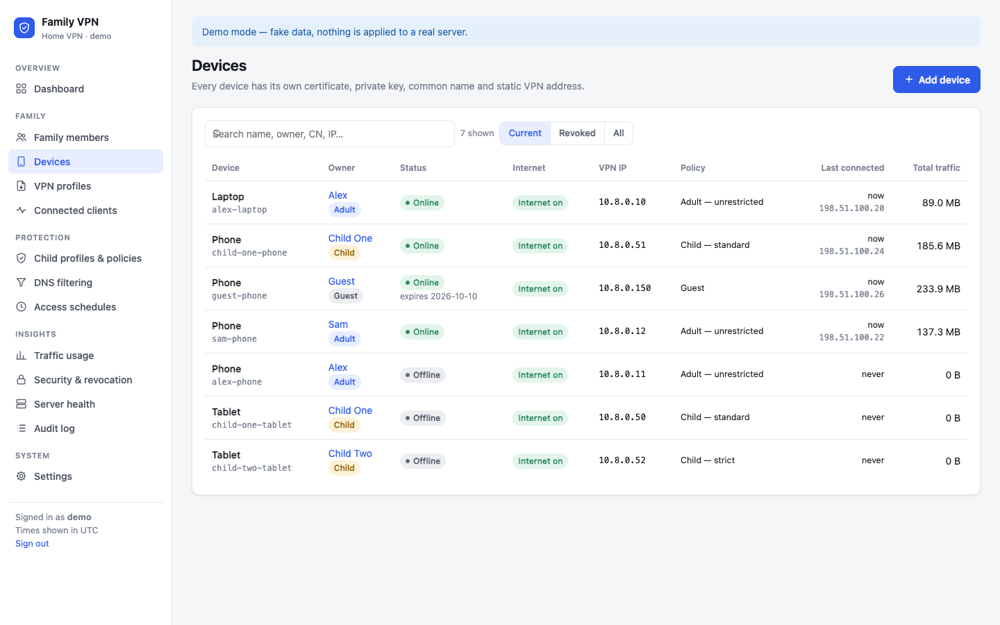
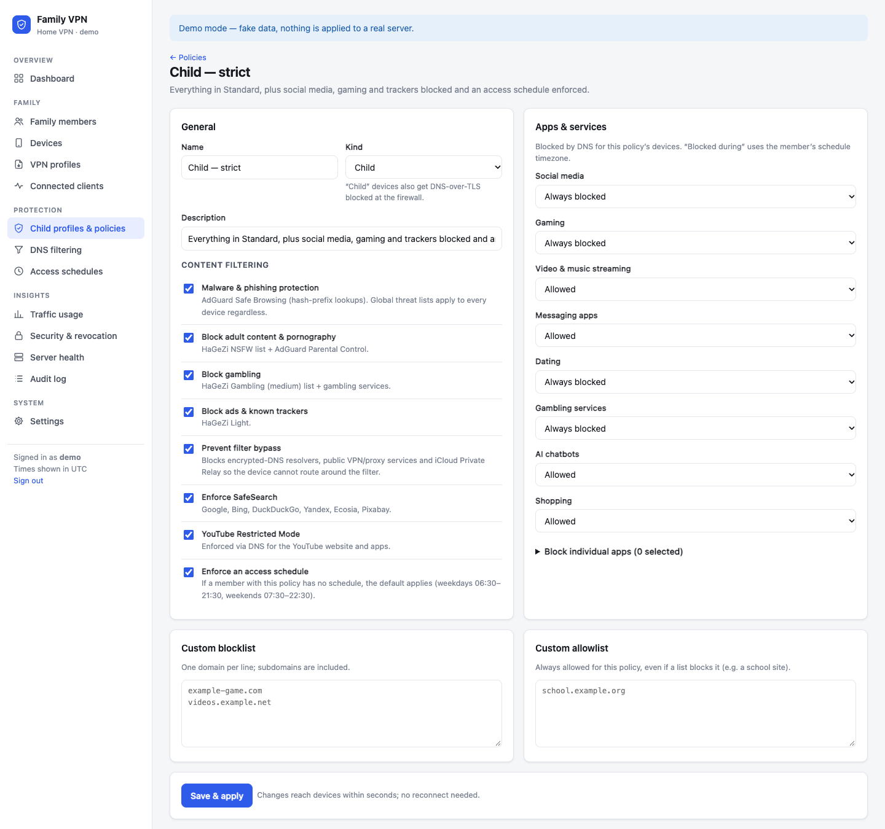
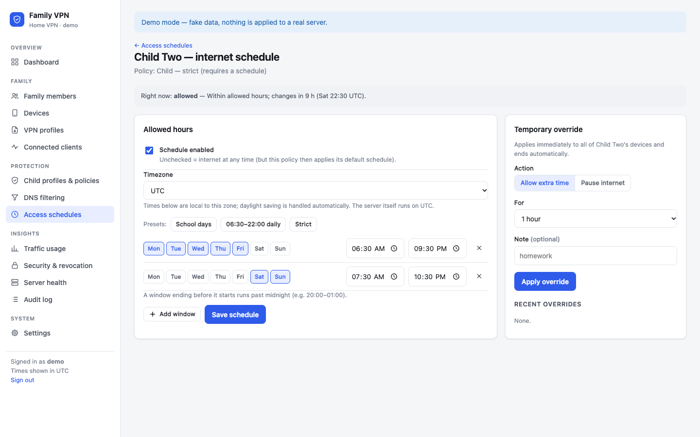
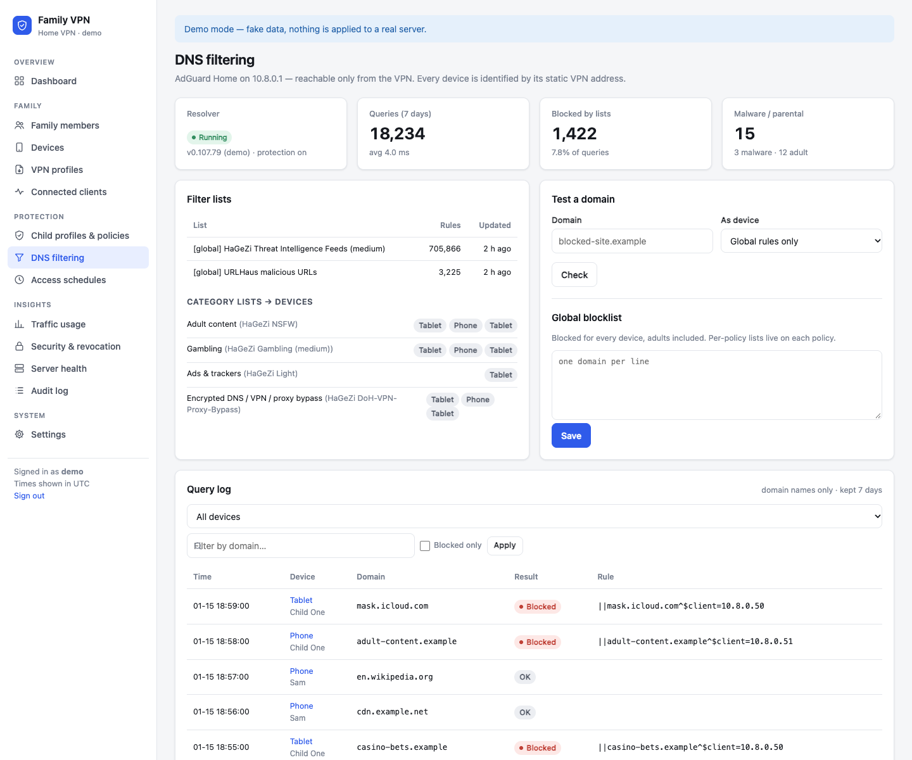
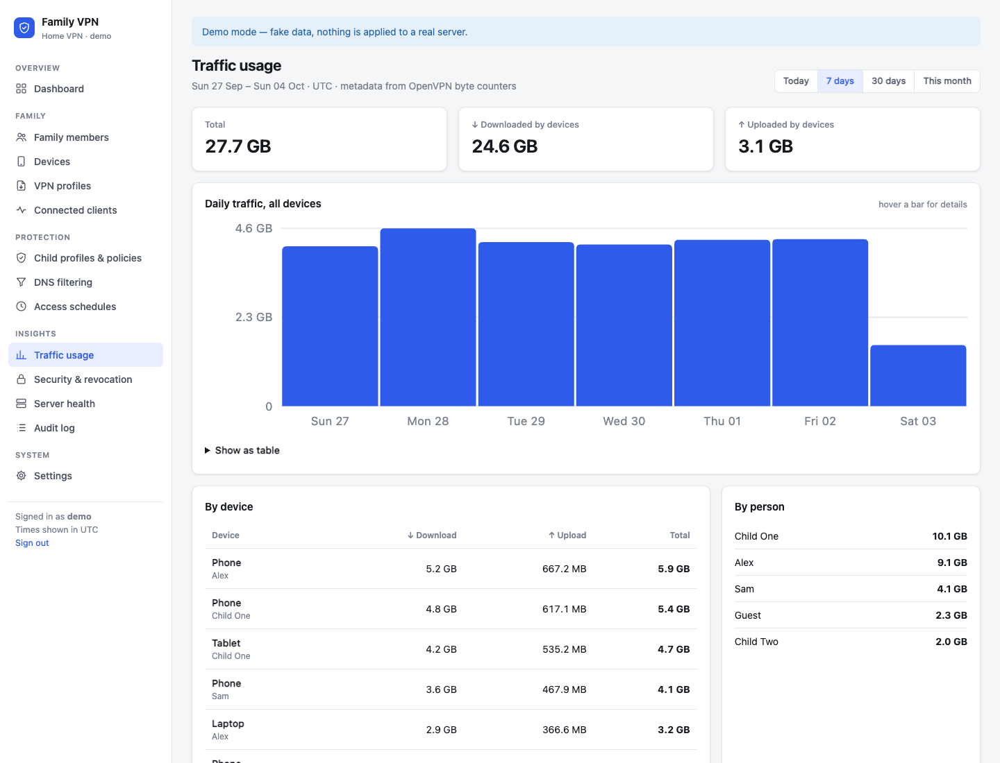
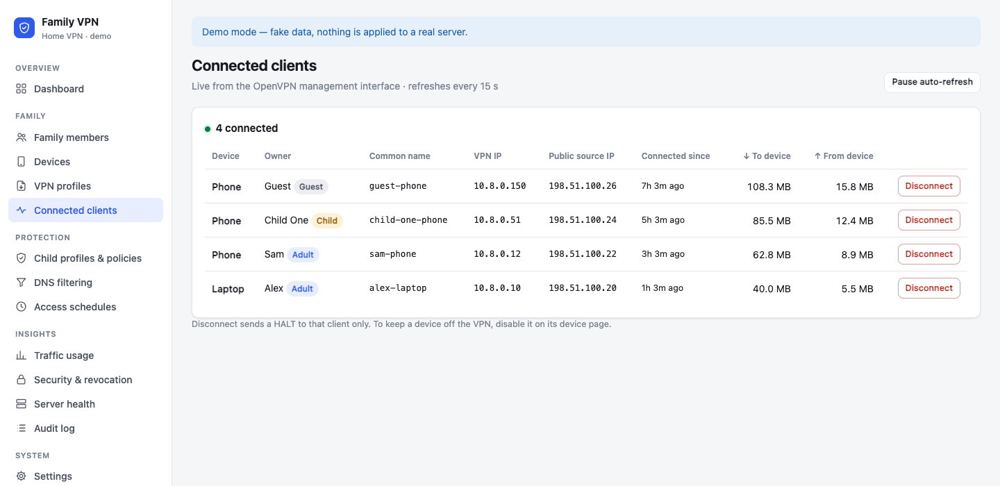
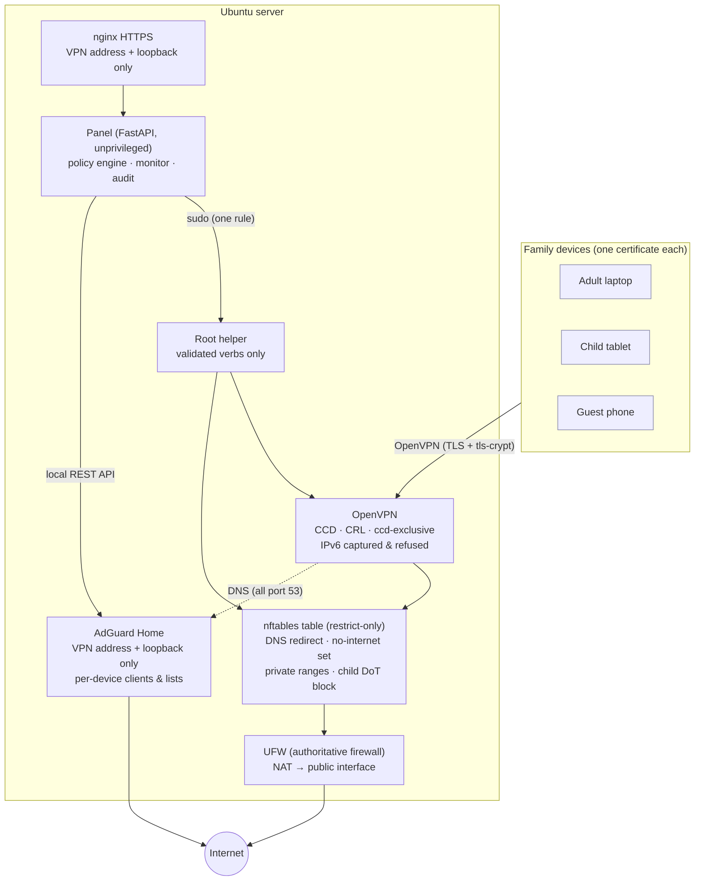

# Family VPN Panel

A self-hosted OpenVPN management panel for families: **one certificate per device**, DNS filtering
with AdGuard Home, Adult / Child / Guest policies, internet schedules, live connection management
and traffic statistics — in a small, auditable web app you run on your own Ubuntu server.



> **Parental network controls, not spyware.** The panel works at the network level only (VPN,
> DNS, firewall). It never intercepts HTTPS, never installs root certificates on children's devices
> and never sees passwords, messages, page contents or banking data. See [Privacy](#privacy).

## Why

A typical home OpenVPN setup has one `.ovpn` file shared by several phones. Because every phone
presents the *same* certificate, OpenVPN treats them as one client and keeps disconnecting the
older session; nobody can tell devices apart, revoke one lost phone, or apply different rules to a
child's tablet. Family VPN Panel replaces that with proper per-device identities and gives a parent a
friendly UI for everything that used to require Easy-RSA, `server.conf` edits and shell commands.

## Features

| | |
|---|---|
| **Per-device VPN identities** | Each device gets its own Easy-RSA certificate, private key, Common Name, static VPN IP and `.ovpn` profile. `duplicate-cn` is never used. |
| **Certificate lifecycle** | Create, download (time-limited, encrypted at rest), regenerate, disable/re-enable, and revoke with a real CRL (`crl-verify`). Client keys are shredded on the server right after the profile is built. |
| **Family members & devices** | People (Adult / Child / Guest) own devices; policies attach to a person and can be overridden per device. |
| **Fixed VPN addresses** | Automatic allocation from per-type ranges, enforced with `client-config-dir` + `ccd-exclusive`. |
| **Connected clients** | Live view from the OpenVPN management interface (local Unix socket) with per-session disconnect. |
| **DNS filtering** | AdGuard Home bound to the VPN only; every device is a separate AdGuard client keyed by its static IP. All client DNS is redirected to it, so filtering can't be bypassed by choosing another resolver. |
| **Child policies** | Adult content, gambling, malware/phishing, ads & trackers, encrypted-DNS/VPN bypass, SafeSearch, YouTube Restricted Mode, per-category app/service blocking (social, gaming, streaming…) with optional time windows, custom block/allow lists. |
| **Schedules & overrides** | Allowed hours per person (timezone- and DST-aware, past-midnight windows), plus one-click "+60 min" or "pause internet". Enforced in the firewall, so it works for every app. |
| **Internet on/off** | Per device; a device can stay on the VPN (DNS, panel) without internet access. |
| **Guests** | Expiring profiles that are disabled automatically, no access to private networks. |
| **Traffic & history** | Per-device and per-person usage (hourly buckets), connection history, recent DNS lookups per device. |
| **Security & audit** | Argon2id logins, CSRF protection, lockout and rate limiting, strict CSP, audit log of every sensitive action, CRL/CA expiry monitoring, unmanaged-certificate adoption. |
| **Server health** | Services, listeners, NAT, firewall table, CPU/RAM/disk at a glance. |
| **Backups** | Nightly root-only archives of PKI, configuration and the panel database, with a documented restore. |

<table>
<tr>
<td></td>
<td></td>
</tr>
<tr>
<td></td>
<td></td>
</tr>
<tr>
<td></td>
<td></td>
</tr>
</table>

*Screenshots use the built-in demo mode with fictional people and documentation addresses.*

## Architecture



The panel computes the desired state from its database (people, devices, policies, schedules) and
pushes only what changed: CCD files and CRL to OpenVPN, address sets to nftables, per-device clients
and category lists to AdGuard Home. Details: [docs/ARCHITECTURE.md](docs/ARCHITECTURE.md).

## Quick start

On a fresh **Ubuntu 24.04** server with a public IP, as a user with sudo:

```bash
git clone https://github.com/<you>/family-vpn-panel.git
cd family-vpn-panel
sudo deploy/install.sh                     # first run creates /etc/vpnpanel/panel.env and stops
sudo nano /etc/vpnpanel/panel.env          # set at least VPN_PUBLIC_HOST
sudo deploy/install.sh --setup-openvpn --setup-adguard --configure-firewall
sudo vpnpanel-admin create-admin alex
```

Then trust `/etc/vpnpanel/panel-ca.crt` on your admin device, connect to the VPN and open
`https://10.8.0.1:8443` (or use an SSH tunnel). Full guide: [docs/INSTALLATION.md](docs/INSTALLATION.md).
Already running OpenVPN? Read [docs/OPENVPN.md](docs/OPENVPN.md) first — the installer never
overwrites an existing server.

Try the UI locally without a server:

```bash
python3 -m venv .venv && .venv/bin/pip install -r requirements-dev.txt
VPNPANEL_FAKE=1 .venv/bin/python tools/demo_seed.py
VPNPANEL_FAKE=1 .venv/bin/uvicorn app.main:app --port 8765    # sign in: demo / demo-password-123
```

## Security model

* The admin panel listens only on the VPN address and loopback (nginx, TLS from a private CA that is
  **name-constrained** to the panel's own addresses). Only adult devices you flag can reach it.
* The OpenVPN management interface is a root-only Unix socket. AdGuard Home's UI/API is loopback-only.
* The web app runs unprivileged; one root helper with strict argument validation performs all
  privileged actions through a single sudoers rule.
* Certificates are unique per device, revocation goes through the CRL, client private keys are never
  stored or logged.
* VPN clients cannot reach private ranges, other clients or cloud metadata endpoints; IPv6 is captured
  in the tunnel and refused so it can't leak around an IPv4 VPN; DNS is forced through the filter.

Read [docs/SECURITY.md](docs/SECURITY.md) for the full model and how to report vulnerabilities.

## Privacy

The panel stores connection metadata (time, duration, VPN IP, public source IP, byte counters) and,
through AdGuard Home, DNS query names for 7 days by default. It does **not** capture HTTPS content,
messages, passwords, banking data or decrypted TLS traffic, and it is not designed for covert
monitoring. Be transparent with your family about what is filtered and logged.

## Documentation

| Topic | |
|---|---|
| [Installation](docs/INSTALLATION.md) | Fresh Ubuntu server, step by step |
| [Configuration](docs/CONFIGURATION.md) | Every `panel.env` setting |
| [OpenVPN](docs/OPENVPN.md) | Required server directives, adopting an existing server |
| [DNS filtering](docs/DNS-FILTERING.md) | AdGuard Home integration, lists, privacy |
| [Parental controls](docs/PARENTAL-CONTROLS.md) | Policies, schedules, overrides, limits |
| [Operations](docs/OPERATIONS.md) | Daily use, CLI, upgrades, backup & restore |
| [Security](docs/SECURITY.md) | Threat model, hardening, vulnerability reporting |
| [Architecture](docs/ARCHITECTURE.md) | Components and data flow |
| [Development](docs/DEVELOPMENT.md) | Demo mode, tests, contributing |
| [Troubleshooting](docs/TROUBLESHOOTING.md) | Common problems |

## Status

Built for a single household on one server. Tested end-to-end on Ubuntu 24.04 with OpenVPN 2.6,
Easy-RSA 3.1 and AdGuard Home v0.107. Multi-server setups, multiple admin roles and WireGuard are
out of scope for now.

## License

[Apache License 2.0](LICENSE). Third-party components are listed in
[THIRD_PARTY_NOTICES.md](THIRD_PARTY_NOTICES.md).
